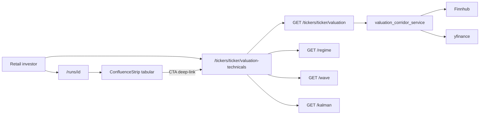
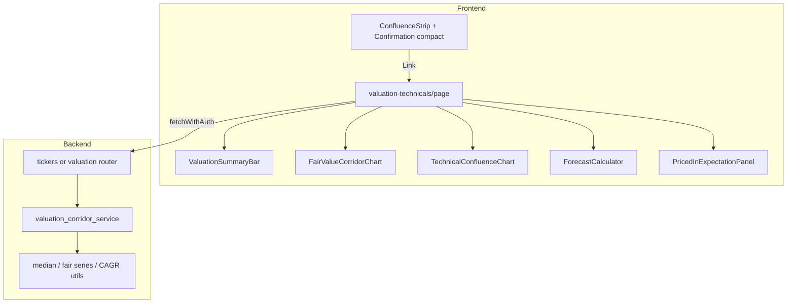

# Tasks

## Active Task

**ID:** valuation-technicals-subview  
**Title:** Dedicated Valuation & Technicals subpage + strip charts from Signal Confluence  
**Created:** 2026-11-01  
**Status:** BUILD Phase 0–4 complete (Phase 5 partial) → next `/reflect` or commit  
**Complexity:** Level 4 (Complex System)

### Goal

Separate interactive charting from Signal Confluence (tabular signals + deep-link), and ship an Aktienfinder-inspired **Valuation & Technical Confluence** page with fair-value corridors, multi-timeframe technicals, forecast/CAGR controls, and integrated priced-in expectation matrix.

### Status checklist

- [x] Initialization (VAN) complete
- [x] Planning complete
- [x] Technology validation (locked stack) — corridor lib install gated on C1
- [x] Creative phases C1–C4 — see `memory-bank/creative/creative-valuation-technicals.md`
- [x] Phase 0 commit priced-in WIP (`7c21e8f`)
- [x] Phase 1 confluence tabular + deep link + stub page
- [x] Phase 2 valuation API + corridor service
- [x] Phase 3 corridor UI (recharts)
- [x] Phase 4 technicals + forecast + priced-in dual cards
- [x] Phase 5 partial (CLAUDE.md, tests, disclaimers); markers/prefetch deferred

---

## PLAN (Level 4) — 2026-11-01

### Architectural principles

1. **Parallel extension** — do not rewrite run detail; add ticker-scoped valuation page + thin confluence refactor.
2. **Server owns valuation math** — corridor series, median multiples, CAGR inputs computed in backend (testable, no look-ahead by default).
3. **Charts are views** — confluence stays signal/table; charts only on valuation-technicals route.
4. **Vendor adapters** — Finnhub primary where entitled; yfinance fallback for history (same pattern as regime/kalman).
5. **Research-only copy** — corridors / priced-in are estimates, not trade advice (Morning Desk).

### System context

### Component architecture

### Locked decisions (PLAN / ADRs)

| Topic | Decision |
|---|---|
| Research hub URL | **Do not invent `/research` in v1.** Keep Signal Confluence on `/runs/[id]`. Map spec “research page” → run detail sidebar. |
| Chart subpage route | **`/tickers/[ticker]/valuation-technicals`** under `app/(app)/` (short nav: “Valuation & Charts”). Query `?from=run&runId=` optional for breadcrumb. |
| Spec `/research/:ticker/...` | Deferred; optional alias later if product wants a Research hub. |
| Confluence charts | Remove `ChartQuickLook` from Markov/Kalman/Wave **`variant="compact"`** (used by `ConfluenceStrip`). Keep charts on valuation page; keep `/wave/[ticker]` for Elliott detail; default variants may keep quick-look. |
| Deep link CTA | Confluence header or footer: `Open Valuation & Technicals →`. |
| Phase 0 precursor | **Commit** current priced-in confluence WIP before Phase 1 chart strip. |
| Persistence | v1: **no DB** for slider assumptions (URL query or component state only). |
| Look-ahead | Live corridor uses only data as-of today; historical replay mode explicit if added. |
| OHLC lib | TradingView **`lightweight-charts` ^5.2** (latest 5.2.1) — locked. |
| Corridor lib | **`recharts`** (C1 decided). |
| API shape | Prefer **`GET /tickers/{ticker}/valuation`** on existing `tickers` router (parallel to metadata/logo) over a new top-level prefix. |
| Corridor data | **yfinance-first history**; Finnhub for metrics/calendar + paid financials/estimates upgrade (C3). |

### Creative phases — DECIDED 2026-11-01

| ID | Decision | Doc |
|---|---|---|
| C1 | **`recharts`** for fair-value corridor (not echarts/Plotly) | `creative/creative-valuation-technicals.md` |
| C2 | Soft success/danger bands + “Below/Above fair value” labels; never Buy/Sell | same |
| C3 | Dual-path **yfinance-first** corridor history; Finnhub metrics/calendar; `source` flags | same |
| C4 | Dual cards: Event (mock vol) + Growth (implied vs consensus ladder); no merged % | same |

**Still locked from PLAN:** route shape; confluence chart removal; `lightweight-charts` OHLC; backend compute; API path.

### Technology validation (gate)

| Check | Result / plan |
|---|---|
| Next App Router | Add `frontend/app/(app)/tickers/[ticker]/valuation-technicals/page.tsx` (mirrors `wave/[ticker]`) |
| `lightweight-charts` | New dep ^5.2.1 — OHLC + markers; dispose on ticker change |
| Corridor lib | **`recharts`** — PoC: 1 price series + 3 fair lines + band |
| Stats | Prefer **local utils** (median, CAGR); `simple-statistics` only if needed |
| Backend | Extend `tickers.py`; `services/valuation_corridor_service.py` (yfinance-first) |
| Existing Plotly | Keep for `/wave/[ticker]` only |
| Current FE chart deps | Plotly present; install `recharts` + `lightweight-charts` in BUILD |
| PoC BUILD gate | Smoke page with mock corridor + one live price series |

**Technology checkpoint:** PASS — C1/C3 decided; install libs in BUILD Phase 3/4.

### Codebase touchpoints (validated 2026-11-01)

| Area | Files |
|---|---|
| Confluence host | `frontend/components/runs/ConfluenceStrip.tsx`, `RunSummaryPanel.tsx` |
| Compact charts to strip | `MarkovConfirmation.tsx`, `KalmanConfirmation.tsx`, `WaveConfirmation.tsx` (`ChartQuickLook` in compact) |
| Priced-in WIP (Phase 0) | `PricedInConfirmation.tsx`, `lib/pricedIn.ts`, `lib/pricedIn.test.ts` |
| Page shell pattern | `frontend/app/(app)/wave/[ticker]/page.tsx` |
| Existing ticker API | `backend/app/routers/tickers.py` (metadata, logo) — extend here |
| Fundamentals today | Portfolio-only Finnhub metrics (`portfolio.py` `_fetch_fundamentals`) — **not** historical EPS/OCF series |
| Auth | `get_current_user` on new GET; FE `fetchWithAuth` |

### Phased implementation

#### Phase 0 — Baseline (≤1 day)

- Commit/push priced-in heuristic + `PricedInConfirmation` + tests.
- Archive `priced-in-event-badge` Memory Bank archive if still untracked.
- **Exit:** clean tree for valuation work.

#### Phase 1 — Confluence tabular + deep link

- In compact variants: drop `ChartQuickLook`; keep signal chips + key metrics.
- Normalize status chips: `CONFIRMS` / `CONFLICTS` / `NEUTRAL` / `PRICE_IN`.
- CTA → `/tickers/{ticker}/valuation-technicals?from=run&runId={id}`.
- Stub page: title, breadcrumb, placeholder panels.
- **Exit:** run detail confluence chart-free; link works.

#### Phase 2 — Data pipeline + valuation API

- Fetch annual (or quarterly) EPS, OCF/share, FCF/share, revenue/share + daily closes + FY+1..3 estimates.
- Median multiples for lookbacks **3Y / 5Y / 10Y** (15Y if data exists).
- Fair series: `EPS_t × med(P/E)`, `OCFPS_t × med(P/OCF)`, `FCFPS_t × med(P/FCF)`.
- Response: `{ summary, series: { price, fairEps, fairOcf, fairFcf }, multiples, estimates, pricedIn }`.
- In-process cache (6–24h) + Finnhub semaphore reuse.
- Unit tests for median/corridor/CAGR pure functions.
- **Exit:** authenticated GET non-empty for liquid US ticker when keys present; empty graceful otherwise.

#### Phase 3 — Valuation page UI (post-creative C1/C2)

- Summary bar: ticker, price, P/E, P/FCF, EV/EBITDA, div yield, priced-in indicator.
- Fair Value Corridor chart + metric toggles + lookback select.
- Undervaluation / overvaluation bands vs selected fair line.
- **Exit:** visual parity with creative comps on desktop + tablet.

#### Phase 4 — Technicals + forecast + priced-in matrix

- `lightweight-charts` candlestick/area + confluence markers (regime/wave/kalman as markers, not ChartQuickLook).
- Forecast: terminal multiple slider; dashed FY extensions; total return + CAGR from spot.
- Priced-in matrix: implied growth vs consensus; mock vol heuristic secondary until options feeds.
- **Exit:** interactive CAGR updates; ticker switch cleans chart instances.

#### Phase 5 — Hardening

- Prefetch from run page; QueryClient keys by ticker.
- No double-fetch; chart dispose on unmount.
- CLAUDE.md short section; research disclaimers.
- Focused FE/BE tests + manual tablet check.
- **Exit:** acceptance themes 1–7 met for v1 scope.

### Component map

| Layer | Pieces |
|---|---|
| Frontend pages | `app/(app)/tickers/[ticker]/valuation-technicals/page.tsx` |
| Frontend UI | `ValuationSummaryBar`, `FairValueCorridorChart`, `TechnicalConfluenceChart`, `ForecastCalculator`, `PricedInExpectationPanel`; slimmed confirmation rows |
| Frontend lib | `valuationTypes.ts`, `cagr.ts`, extend `pricedIn.ts` |
| Backend | `GET /tickers/{ticker}/valuation`; `services/valuation_corridor_service.py`; tests |
| Nav | Optional holdings/ticker-drawer link later (YAGNI until Phase 3) |

### Challenges & mitigations

| Challenge | Mitigation |
|---|---|
| Sparse FCF/OCF history | Toggle metrics; hide lines without data; “insufficient history” |
| Finnhub estimate gaps | yfinance fallback; mock estimates flagged in UI |
| DESIGN green/red bands | C2 — success/danger-soft + “valuation” labels, not buy/sell wording |
| Confluence performance | Phase 1 removes Plotly/SVG from strip |
| Scope creep | v1 = PE/OCF/FCF corridors + one forecast slider + markers; no multi-model DCF suite |

### Testing strategy

- Backend: pure math (median multiples, fair series, CAGR); API 401/empty/happy.
- Frontend: priced-in/score tests; forecast CAGR util; chart unmount smoke.
- QA: AAPL↔MSFT; tablet resize; Finnhub key off → empty states.

### Time estimate (rough)

| Phase | Effort |
|---|---|
| 0 | 0.5 d |
| 1 | 1–2 d |
| 2 | 3–5 d |
| 3 | 2–4 d (after creative) |
| 4 | 3–5 d |
| 5 | 1–2 d |
| **Total** | **~2–3 weeks** calendar |

### PLAN verification

| Check | Result |
|---|---|
| Requirements documented | YES |
| Technology stack validated (locked + C1 gate) | YES |
| Affected components identified | YES |
| Implementation steps detailed | YES |
| Dependencies documented | YES |
| Challenges & mitigations | YES |
| Creative phases identified | YES (C1–C4) |
| tasks.md updated | YES |

### BUILD readiness checklist

- [x] `/creative` resolves C1–C4
- [x] Phase 0 committed
- [x] Phase 1 executed
- [x] Phase 2 executed
- [x] Phase 3–4 executed
- [x] Phase 5 partial
- [x] No look-ahead in trailing median multiples (valuation_math)
- [x] Disclaimers on valuation + priced-in panels

### Next Mode

**`/reflect`** (after optional commit of Phases 1–5 work), or continue BUILD for confluence markers + implied CAGR.
